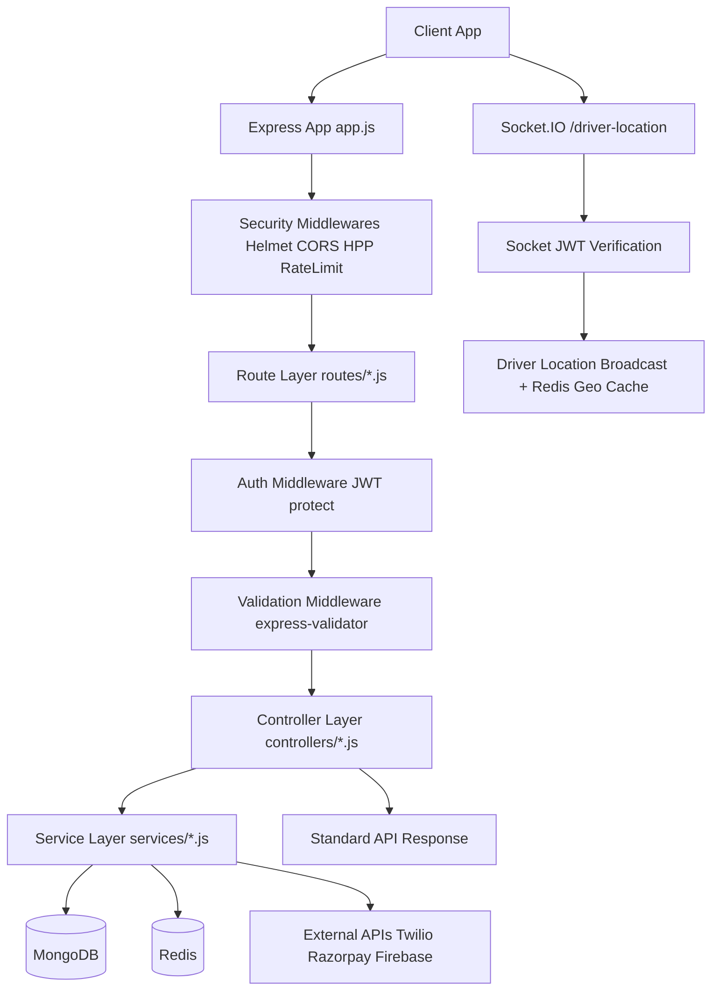

# RickRide Backend

Production-ready Node.js/Express backend for a ride-sharing platform (Rickshaw + Cab style workflows), including OTP authentication, trip creation, seat booking, payment processing, push notifications, file uploads, and real-time driver location tracking.

## What This API Does
- Handles rider/driver/admin accounts.
- Supports OTP login (Twilio or mock OTP in development).
- Creates and manages trips, bookings, ratings, driver/vehicle profiles.
- Processes payments with Razorpay and verifies signatures/webhooks.
- Sends FCM push notifications after successful payment confirmation.
- Streams live driver locations via Socket.IO.
- Exposes OpenAPI/Swagger docs for testing and integration.

## Tech Stack

| Package | Why It Exists In This Project |
|---|---|
| cors | Allows frontend apps (for example localhost:8081) to call this API safely. |
| dotenv | Loads environment variables from .env for local/dev setup. |
| express | Main HTTP server framework for all REST APIs. |
| express-rate-limit | Protects endpoints from brute-force and request floods. |
| express-validator | Validates request payloads and rejects invalid input early. |
| firebase-admin | Sends FCM push notifications (for example payment confirmed). |
| helmet | Sets secure HTTP headers to reduce common web attack risks. |
| hpp | Blocks HTTP parameter pollution attacks. |
| jsonwebtoken | Issues/verifies JWT tokens for protected routes and sockets. |
| mongoose | ODM layer for MongoDB models and query logic. |
| multer | Handles multipart file uploads to public/uploads. |
| nodemon | Auto-restarts server in development mode. |
| razorpay | Creates Razorpay orders and validates payment/webhook signatures. |
| redis | Caches live driver location/status and reduces DB load. |
| socket.io | Real-time channels for driver location updates and rider tracking. |
| swagger-jsdoc | Builds OpenAPI JSON from route JSDoc comments. |
| swagger-ui-express | Hosts Swagger UI at /api-docs. |
| twilio | Sends/verifies OTP SMS in production OTP flow. |
| winston | Structured application logging. |
| winston-daily-rotate-file | Rotates log files daily for production operations. |

## Architecture Overview



## Request Flow (Simple)
1. Request enters app.js.
2. Security middlewares run.
3. Route matches endpoint.
4. protect middleware verifies JWT (if route is protected).
5. validate middleware checks body/query/params.
6. Controller runs business logic.
7. Controller calls service/model/external API.
8. Success response uses utils/apiResponse.
9. Errors go to centralized middlewares/errorHandler.

## Firebase (FCM) Implementation In This Project
- Firebase Admin is initialized in config/firebase.js.
- It supports either:
  - FIREBASE_SERVICE_ACCOUNT_JSON (single JSON string), or
  - Split fields: FIREBASE_PROJECT_ID, FIREBASE_CLIENT_EMAIL, FIREBASE_PRIVATE_KEY.
- notification.service.js uses admin.messaging().send().
- payment.controller.js triggers notification after payment is completed and booking is confirmed.
- If Firebase is not configured, the code falls back to mock logging instead of crashing.

## Environment Variables
Copy .env.example to .env and fill values.

### Core
- NODE_ENV: development or production.
- PORT: API port (default 5000).
- APP_BASE_URL: Used by Swagger server URL and docs links.
- CORS_ORIGIN: Allowed frontend origin(s), comma-separated.

### Database/Cache
- MONGO_URI: Mongo connection string.
- MONGO_DB_NAME: Optional DB name override.
- REDIS_URI: Redis connection string.

### Auth
- JWT_SECRET: JWT signing secret. Must be strong in production.
- JWT_EXPIRES_IN: Token lifetime (for example 7d).

### Rate Limiting
- RATE_LIMIT_WINDOW_MS: Global limiter window.
- RATE_LIMIT_MAX: Max requests per window.
- AUTH_RATE_LIMIT_MAX: Stricter limit for auth routes.

### Twilio
- TWILIO_ACCOUNT_SID, TWILIO_AUTH_TOKEN: Twilio credentials.
- TWILIO_SERVICE_SID: Verify service SID (preferred OTP mode).
- TWILIO_PHONE_NUMBER: Sender number for direct SMS fallback.

### Razorpay
- RAZORPAY_KEY_ID, RAZORPAY_KEY_SECRET: Order creation and signature verification.
- RAZORPAY_WEBHOOK_SECRET: Verifies webhook authenticity.

### Firebase
- FIREBASE_SERVICE_ACCOUNT_JSON: Full service account JSON as string (recommended).
- FIREBASE_PROJECT_ID, FIREBASE_CLIENT_EMAIL, FIREBASE_PRIVATE_KEY: Alternative split config.
- FIREBASE_DATABASE_URL, FIREBASE_STORAGE_BUCKET: Optional Firebase services.
- FCM_SERVER_KEY: Legacy field (not required by firebase-admin, kept for compatibility).

### Optional
- MAX_UPLOAD_SIZE_MB: Upload file size limit.
- LOG_LEVEL: Logging level (debug/info/warn/error).

## Local Setup
```bash
npm install
cp .env.example .env
npm run dev
```

API base URL: http://localhost:5000

Health endpoint:
```bash
curl http://localhost:5000/health
```

Swagger docs:
- UI: http://localhost:5000/api-docs
- JSON: http://localhost:5000/api-docs.json

## Build and Start
This project is plain Node.js (no TypeScript transpile step).

```bash
npm run build
npm start
```

## Docker

### Build and Run with Compose
```bash
docker compose up --build
```

What compose now includes:
- Production NODE_ENV for backend container.
- Health checks for backend, MongoDB, and Redis.
- Backend starts only after Mongo/Redis become healthy.

### Build Image Only
```bash
docker build -t rickride-backend .
```

### Run Image Only
```bash
docker run --env-file .env -p 5000:5000 rickride-backend
```

## Deployment Notes (Cloud)
- Set NODE_ENV=production.
- Use managed MongoDB and Redis in production.
- Set a strong JWT_SECRET.
- Configure Razorpay webhook secret and endpoint.
- Configure Firebase service account vars for push notifications.
- Do not rely on local public/uploads for critical docs in production; use object storage (S3/GCS).

## Security Improvements Included
- Production guard for weak JWT secret.
- Socket authentication with JWT and role/driver ownership checks.
- Coordinate validation for trip and location updates.
- Atomic trip seat reservation to prevent overbooking race conditions.
- Payment verification idempotency to handle duplicate webhook calls.
- Graceful shutdown now closes HTTP, MongoDB, and Redis connections.

## Folder Guide (Quick)
- config: environment + DB/Redis/Firebase setup.
- controllers: endpoint business logic.
- middlewares: auth/validation/rate/error pipeline.
- models: Mongo schemas.
- routes: API endpoint declarations + validation.
- services: Twilio/Razorpay/FCM/geo/matching logic.
- sockets: real-time location namespace.
- utils: logging, JWT, responses, uploads, crypto helpers.
- scripts: operational scripts (for example admin seeding).

## Operational Checklist
- .env configured with real production secrets.
- MongoDB/Redis reachable from runtime network.
- Razorpay webhook route reachable publicly.
- HTTPS termination configured at load balancer/reverse proxy.
- Logs are persisted/aggregated.
- Swagger disabled or protected in strict production if needed.

## License
ISC
