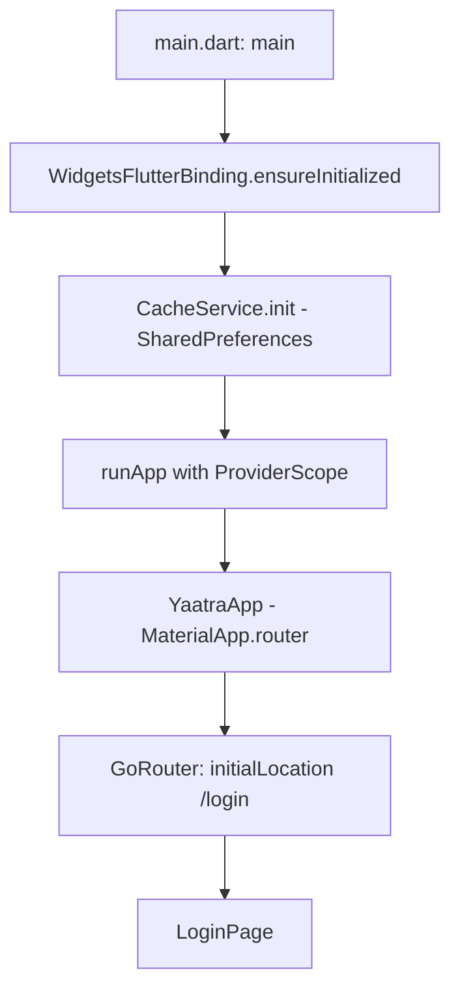
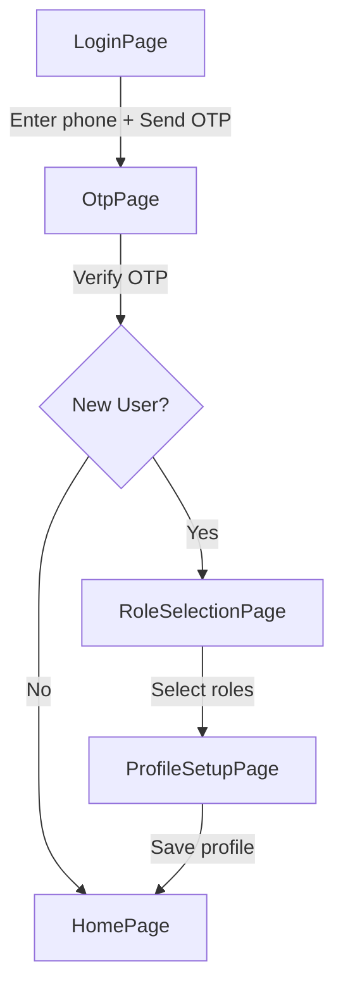
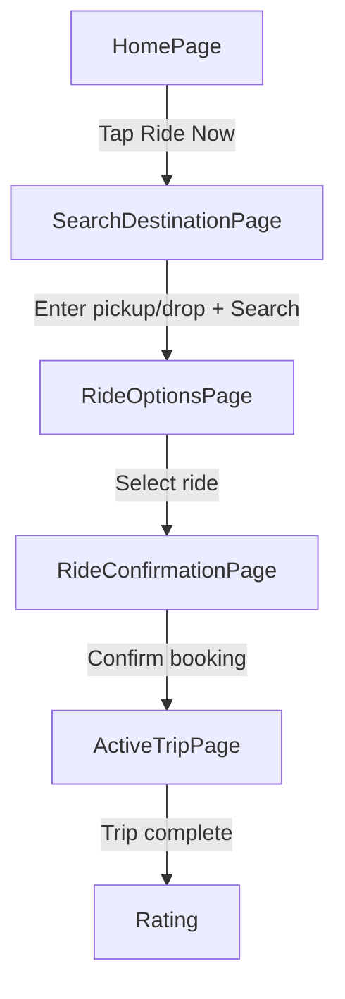
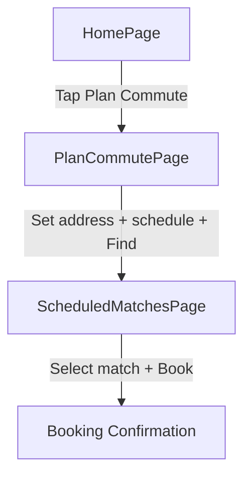
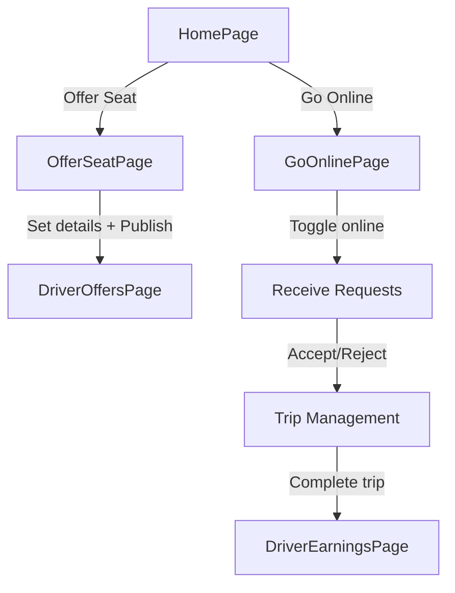

# Yaatra - Unified Shared Mobility App

A Flutter mobile application that connects riders with carpool drivers and professional drivers for affordable, shared commuting in India.

---

## Table of Contents

- [Project Overview](#project-overview)
- [Features](#features)
- [Tech Stack](#tech-stack)
- [Prerequisites](#prerequisites)
- [Installation & Setup](#installation--setup)
- [Running the Project](#running-the-project)
- [Project Architecture](#project-architecture)
- [Project Structure](#project-structure)
- [Application Flow](#application-flow)
- [Navigation](#navigation)
- [State Management](#state-management)
- [API & Networking](#api--networking)
- [Local Storage](#local-storage)
- [Theme & Styling](#theme--styling)
- [Assets](#assets)
- [Building for Release](#building-for-release)
- [Testing](#testing)
- [Debugging & Troubleshooting](#debugging--troubleshooting)
- [Maintenance & Updates](#maintenance--updates)
- [Developer Quick Reference](#developer-quick-reference)

---

## Project Overview

**Yaatra** is a unified shared mobility app for India that blends **instant shared rides** and **planned daily carpooling**. It connects riders with nearby drivers — whether they are carpool owners sharing their commute or professional drivers — to make every journey shared, affordable, and reliable.

### Problem It Solves

Urban Indian commuters face a painful trade-off: ride-hailing is too expensive for daily use, and existing carpooling apps are unreliable for real-time needs and lack trust. There is no seamless way to find a ride right now *or* plan a regular commute with the same community of nearby people.

### Target Users

- **Riders**: People looking for affordable shared rides (instant or scheduled)
- **Carpool Drivers**: Car owners who want to share empty seats on their daily commute
- **Professional Drivers**: Cab drivers who want pooled ride requests to maximize earnings

### Target Market

India — initially targeting Bangalore, Delhi NCR, Mumbai, Hyderabad, and Pune.

---

## Features

### Authentication & Onboarding
- Phone number + OTP login
- Role selection (Rider, Driver, Professional, or both)
- Profile setup (name, gender, profile photo)

### Rider Features
- **Ride Now**: Find and book instant shared rides
- **Plan Commute**: Schedule recurring daily carpools (Mon-Fri, specific times)
- Filter rides by type (Carpool, Professional, Women-Only)
- Ride booking confirmation with fare breakdown
- Active trip tracking with driver info and ETA

### Driver Features
- **Offer Seat**: Publish daily commute with available seats, schedule, and pricing
- **Go Online**: Toggle online/offline to receive ride requests
- **Driver Offers**: Manage published ride offers
- **Earnings**: View earnings, transactions, and withdraw funds

### Ride Management
- Upcoming rides list
- Ride history with status (completed, cancelled)
- Ride details with rebook, report, and rate options

### Wallet & Payments
- Wallet balance display
- Quick top-up actions (UPI, Card, Bank)
- Transaction history

### Safety Features
- Emergency SOS button
- Share trip with contacts
- Trust badges (Verified, Carpool, Professional, Women-Only)
- Report issue functionality
- Emergency contacts

### Notifications
- In-app notification center
- Read/unread states
- Mark all as read

### Profile & Settings
- Profile management
- Language selector (English/Hindi)
- Notification preferences
- Privacy & security settings

---

## Tech Stack

| Technology | Purpose | Version |
|------------|---------|---------|
| **Flutter** | UI framework | SDK ^3.13.2 |
| **Dart** | Programming language | Bundled with Flutter |
| **Riverpod** | State management | ^2.6.1 |
| **GoRouter** | Navigation/routing | ^14.8.1 |
| **Dio** | HTTP client for API calls | ^5.7.0 |
| **Socket.IO Client** | Real-time communication | ^3.0.2 |
| **Flutter Secure Storage** | Secure token storage | ^9.2.4 |
| **Shared Preferences** | Local key-value storage | ^2.3.5 |
| **Google Maps Flutter** | Map display | ^2.10.1 |
| **Google Places Autocomplete** | Location search | ^1.0.6 |
| **Geolocator** | GPS location access | ^13.0.1 |
| **Geocoding** | Address ↔ coordinates | ^4.0.0 |
| **Image Picker** | Camera/gallery access | ^1.1.2 |
| **Cached Network Image** | Image caching | ^3.4.1 |
| **Flutter Local Notifications** | Local push notifications | ^18.0.1 |
| **URL Launcher** | Opening URLs/phone calls | ^6.3.1 |
| **intl** | Date/number formatting | ^0.19.0 |

---

## Prerequisites

Before working on this project, ensure you have the following installed:

### Required Software

| Software | Minimum Version | Purpose |
|----------|-----------------|---------|
| **Flutter SDK** | 3.13.2+ | Flutter framework and tools |
| **Dart SDK** | Bundled with Flutter | Dart language compiler |
| **Android Studio** | Latest stable | Android development & emulator |
| **Xcode** | 14.0+ | iOS development (macOS only) |
| **CocoaPods** | 1.15.0+ | iOS dependency management (macOS only) |
| **Git** | 2.30+ | Version control |
| **VS Code** or **Android Studio** | Latest | Code editor |

### Verify Your Installation

Open a terminal and run these commands:

```bash
# Check Flutter installation
flutter --version

# Check for any missing dependencies
flutter doctor

# Check Dart
dart --version

# Check Git
git --version
```

The `flutter doctor` command will show a checklist. Ensure all items have green checkmarks (or at least the ones for your target platform).

---

## Installation & Setup

### Step 1: Clone the Repository

```bash
git clone https://github.com/<your-org>/Yaatra.git
cd Yaatra/yaatra_application
```

### Step 2: Install Flutter (if not already installed)

```bash
# Windows (using Chocolatey)
choco install flutter

# macOS (using Homebrew)
brew install flutter

# Or download from: https://docs.flutter.dev/get-started/install
```

After installation, run:

```bash
flutter doctor
flutter pub get
```

### Step 3: Install Dependencies

From the project root (`yaatra_application/`):

```bash
flutter pub get
```

This downloads all packages listed in `pubspec.yaml`.

### Step 4: Set Up Android

1. Open **Android Studio**
2. Go to **SDK Manager** → Install the latest Android SDK (API 34+)
3. Go to **SDK Tools** → Install Android SDK Build-Tools, Android SDK Platform-Tools
4. Create an Android Virtual Device (AVD): **Device Manager** → **Create Device**
5. Select a Pixel device → Select a system image (API 34 recommended) → Finish

### Step 5: Set Up iOS (macOS only)

1. Install Xcode from the Mac App Store
2. Install CocoaPods:

```bash
sudo gem install cocoapods
```

3. Install iOS dependencies:

```bash
cd ios
pod install
cd ..
```

4. Open `ios/Runner.xcworkspace` in Xcode to verify it builds

### Step 6: Configure Google Maps API Key

The app uses Google Maps. You need API keys:

1. Get a Google Maps API key from [Google Cloud Console](https://console.cloud.google.com/)
2. **Android**: Add your key to `android/app/src/main/AndroidManifest.xml`:

```xml
<meta-data
    android:name="com.google.android.geo.API_KEY"
    android:value="YOUR_API_KEY_HERE"/>
```

3. **iOS**: Add your key to `ios/Runner/AppDelegate.swift` or `ios/Runner/Info.plist`

### Step 7: Configure Backend URL

The app connects to a backend server. The default base URL is:

```
http://10.0.2.2:5001
```

- `10.0.2.2` is the Android emulator's alias for localhost
- For iOS simulator, use `http://localhost:5001`
- For physical devices, use your machine's local IP address

Update the base URL in `lib/core/api/api_endpoints.dart`:

```dart
static const String baseUrl = 'http://10.0.2.2:5001';
```

### Step 8: Connect a Physical Device (Optional)

**Android:**
1. Enable **Developer Options** on your phone
2. Enable **USB Debugging**
3. Connect via USB
4. Run `flutter devices` to verify

**iOS:**
1. Connect your iPhone via USB
2. Open Xcode → Window → Devices and Simulators
3. Trust the developer certificate on your phone

---

## Running the Project

### Select a Device

```bash
# List available devices
flutter devices

# Examples of device selection
flutter run -d android        # Running Android emulator
flutter run -d ios            # iOS simulator
flutter run -d <device-id>    # Specific device
```

### Run the App

```bash
# Debug mode (default) — has hot reload, debugging tools
flutter run

# Or specify a device
flutter run -d android
flutter run -d chrome          # Web (limited functionality)
```

### Build Modes

| Mode | Command | Purpose |
|------|---------|---------|
| **Debug** | `flutter run` | Development with hot reload, debugging, JIT compilation |
| **Profile** | `flutter run --profile` | Performance testing, closer to release |
| **Release** | `flutter run --release` | Production build, optimized, no debugging |

### Hot Reload vs Hot Restart

- **Hot Reload** (`r` in terminal, or save in IDE): Injects updated code without losing state. Fast. Use for UI changes.
- **Hot Restart** (`R` in terminal): Restarts the app completely, losing all state. Use when state logic changes.
- **Full Restart**: Stop and re-run `flutter run`. Use when hot restart doesn't work.

### Stop the App

Press `q` in the terminal, or click the Stop button in your IDE.

---

## Project Architecture

The project follows a **feature-based architecture** with clean separation of concerns:

```
┌─────────────────────────────────────────────────────┐
│                    Presentation                     │
│  (Pages, Widgets, UI Components)                    │
├─────────────────────────────────────────────────────┤
│                    State Management                 │
│  (Riverpod Providers & Notifiers)                   │
├─────────────────────────────────────────────────────┤
│                    Data Layer                       │
│  (Repositories, API Calls, Models)                  │
├─────────────────────────────────────────────────────┤
│                    Core / Shared                    │
│  (Theme, Storage, Utils, Reusable Widgets)          │
└─────────────────────────────────────────────────────┘
```

### Key Architectural Decisions

- **Feature-based organization**: Each feature (auth, home, rides, etc.) is a self-contained module
- **Riverpod for state management**: Reactive, compile-safe dependency injection
- **GoRouter for navigation**: Declarative routing with ShellRoute for bottom navigation
- **Dio for HTTP**: Configurable HTTP client with interceptors for auth tokens
- **Repository pattern**: Data access is abstracted behind repository classes

---

## Project Structure

```
yaatra_application/
├── lib/                              # Main Dart source code
│   ├── main.dart                     # App entry point
│   ├── app.dart                      # Root widget (MaterialApp)
│   │
│   ├── core/                         # Shared utilities and services
│   │   ├── api/
│   │   │   ├── api_endpoints.dart    # All API endpoint URLs
│   │   │   └── dio_client.dart       # HTTP client with auth interceptor
│   │   ├── storage/
│   │   │   ├── cache.dart            # SharedPreferences wrapper
│   │   │   └── token_storage.dart    # Secure JWT token storage
│   │   ├── theme/
│   │   │   ├── app_colors.dart       # Color constants
│   │   │   └── app_theme.dart        # Light & dark theme definitions
│   │   ├── utils/
│   │   │   ├── formatters.dart       # Currency, date, phone formatting
│   │   │   └── validators.dart       # Form input validation
│   │   └── widgets/                  # Reusable UI components
│   │       ├── primary_button.dart   # Styled button (solid/outlined)
│   │       ├── text_field.dart       # Styled text input
│   │       ├── chip_filter.dart      # Filter chip with animation
│   │       ├── driver_card.dart      # Driver info card
│   │       ├── ride_option_card.dart # Ride option display card
│   │       ├── trust_badge.dart      # Trust/verification badges
│   │       ├── skeleton.dart         # Loading skeleton placeholder
│   │       ├── empty_state.dart      # Empty state display
│   │       └── error_state.dart      # Error state display
│   │
│   ├── features/                     # Feature modules
│   │   ├── auth/                     # Authentication
│   │   │   ├── data/
│   │   │   │   └── auth_repository.dart
│   │   │   ├── models/
│   │   │   │   └── user_model.dart
│   │   │   ├── presentation/pages/
│   │   │   │   ├── login_page.dart
│   │   │   │   ├── otp_page.dart
│   │   │   │   ├── role_selection_page.dart
│   │   │   │   └── profile_setup_page.dart
│   │   │   └── providers/
│   │   │       └── auth_providers.dart
│   │   │
│   │   ├── home/                     # Home screen
│   │   │   └── presentation/pages/
│   │   │       └── home_page.dart
│   │   │
│   │   ├── ride_now/                 # On-demand rides
│   │   │   └── presentation/pages/
│   │   │       ├── search_destination_page.dart
│   │   │       ├── ride_options_page.dart
│   │   │       ├── ride_confirmation_page.dart
│   │   │       └── active_trip_page.dart
│   │   │
│   │   ├── plan_commute/             # Scheduled carpools
│   │   │   └── presentation/pages/
│   │   │       ├── plan_commute_page.dart
│   │   │       └── scheduled_matches_page.dart
│   │   │
│   │   ├── driver/                   # Driver features
│   │   │   └── presentation/pages/
│   │   │       ├── offer_seat_page.dart
│   │   │       ├── driver_offers_page.dart
│   │   │       ├── go_online_page.dart
│   │   │       └── driver_earnings_page.dart
│   │   │
│   │   ├── rides/                    # Ride management
│   │   │   └── presentation/pages/
│   │   │       ├── upcoming_rides_page.dart
│   │   │       ├── ride_history_page.dart
│   │   │       └── ride_detail_page.dart
│   │   │
│   │   ├── wallet/                   # Wallet & payments
│   │   │   └── presentation/pages/
│   │   │       └── wallet_page.dart
│   │   │
│   │   ├── notifications/            # Notification center
│   │   │   └── presentation/pages/
│   │   │       └── notification_center_page.dart
│   │   │
│   │   ├── safety/                   # Safety features
│   │   │   └── presentation/pages/
│   │   │       └── safety_page.dart
│   │   │
│   │   └── profile/                  # Profile & settings
│   │       └── presentation/pages/
│   │           ├── profile_page.dart
│   │           └── settings_page.dart
│   │
│   └── router/
│       └── app_router.dart           # All route definitions & bottom nav
│
├── assets/                           # Static resources
│   ├── fonts/                        # Poppins font family (18 TTF files)
│   ├── images/                       # Image assets (currently empty)
│   └── i18n/
│       └── en.json                   # English translations (28 keys)
│
├── android/                          # Android platform code
│   ├── app/
│   │   └── build.gradle.kts          # Android build config
│   ├── build.gradle.kts              # Root Gradle config
│   ├── settings.gradle.kts           # Gradle settings
│   └── gradle.properties             # Gradle properties
│
├── ios/                              # iOS platform code
│   ├── Runner/                       # iOS app target
│   └── Runner.xcworkspace/           # Xcode workspace
│
├── web/                              # Web platform (basic support)
├── pubspec.yaml                      # Project dependencies & config
├── pubspec.lock                      # Locked dependency versions
├── analysis_options.yaml             # Dart analyzer rules
└── README.md                         # This file
```

### Key Files Explained

| File | Purpose | When to Edit |
|------|---------|--------------|
| `lib/main.dart` | App entry point, initializes cache and wraps app in ProviderScope | Rarely |
| `lib/app.dart` | Root widget, sets up MaterialApp with theme and router | When changing app title, theme mode, or root config |
| `lib/router/app_router.dart` | All route definitions and bottom navigation | When adding/removing screens or changing navigation |
| `lib/core/api/api_endpoints.dart` | All API endpoint URLs | When backend endpoints change |
| `lib/core/api/dio_client.dart` | HTTP client with auth interceptor | When changing API configuration, adding interceptors |
| `lib/core/storage/cache.dart` | SharedPreferences wrapper | When adding new cached data |
| `lib/core/storage/token_storage.dart` | JWT token management | When changing auth token handling |
| `lib/core/theme/app_colors.dart` | Color constants | When updating the color palette |
| `lib/core/theme/app_theme.dart` | Light and dark theme definitions | When changing visual styling |
| `lib/core/utils/formatters.dart` | Display formatting utilities | When adding new format types |
| `lib/core/utils/validators.dart` | Form validation rules | When adding/changing validation |
| `lib/features/*/presentation/pages/*.dart` | Screen UI code | When modifying specific screens |
| `lib/features/auth/providers/auth_providers.dart` | Authentication state | When changing auth logic |
| `lib/features/auth/data/auth_repository.dart` | Auth API calls | When changing auth endpoints |
| `lib/features/auth/models/user_model.dart` | User data model | When adding/changing user fields |

---

## Application Flow

### Startup Flow



### Authentication Flow



### Ride Booking Flow (Ride Now)



### Scheduled Commute Flow



### Driver Flow



---

## Navigation

The app uses **GoRouter** (v14.8.1) for declarative routing.

### Route Structure

| Path | Screen | Auth Required |
|------|--------|---------------|
| `/login` | LoginPage | No |
| `/otp` | OtpPage | No |
| `/role` | RoleSelectionPage | No |
| `/profile-setup` | ProfileSetupPage | No |
| `/home` | HomePage | Yes |
| `/ride-now` | SearchDestinationPage | Yes |
| `/ride-now/options` | RideOptionsPage | Yes |
| `/ride-now/confirm` | RideConfirmationPage | Yes |
| `/active-trip/:id` | ActiveTripPage | Yes |
| `/plan-commute` | PlanCommutePage | Yes |
| `/plan-commute/matches` | ScheduledMatchesPage | Yes |
| `/driver/offer` | OfferSeatPage | Yes |
| `/driver/offers` | DriverOffersPage | Yes |
| `/driver/online` | GoOnlinePage | Yes |
| `/driver/earnings` | DriverEarningsPage | Yes |
| `/rides/upcoming` | UpcomingRidesPage | Yes |
| `/rides/history` | RideHistoryPage | Yes |
| `/rides/:id` | RideDetailPage | Yes |
| `/wallet` | WalletPage | Yes |
| `/notifications` | NotificationCenterPage | Yes |
| `/safety` | SafetyPage | Yes |
| `/profile` | ProfilePage | Yes |
| `/settings` | SettingsPage | Yes |

### Bottom Navigation

The `MainShell` widget provides a 5-tab bottom navigation bar:

| Tab | Routes | Icon |
|-----|--------|------|
| Home | `/home` | 🏠 Home |
| Rides | `/rides/*`, `/ride-now/*`, `/plan-commute/*`, `/active-trip/*` | 🚗 Directions Car |
| Wallet | `/wallet` | 💳 Account Balance Wallet |
| Notifications | `/notifications` | 🔔 Notifications |
| Profile | `/profile`, `/settings` | 👤 Person |

### How to Add a New Route

1. Create the page in `lib/features/<feature>/presentation/pages/`
2. Add a `GoRoute` in `lib/router/app_router.dart`
3. If it belongs in the bottom nav, update `_getCurrentIndex()` and `_onTap()`

---

## State Management

The app uses **Riverpod** (v2.6.1) for state management.

### How It Works

- **Providers** declare pieces of state or services
- **Widgets** use `ConsumerWidget` and `ref.watch()` / `ref.read()` to access state
- **StateNotifier** manages complex state with methods to update it

### Key Providers

| Provider | Type | Location | Purpose |
|----------|------|----------|---------|
| `routerProvider` | `Provider<GoRouter>` | `app_router.dart` | App routing |
| `dioClientProvider` | `Provider<DioClient>` | `dio_client.dart` | HTTP client |
| `cacheServiceProvider` | `Provider<CacheService>` | `cache.dart` | Local storage |
| `tokenStorageProvider` | `Provider<TokenStorage>` | `token_storage.dart` | Secure storage |
| `authProvider` | `StateNotifierProvider<AuthNotifier, AuthState>` | `auth_providers.dart` | Auth state |
| `currentUserProvider` | `FutureProvider<UserModel?>` | `auth_providers.dart` | Current user data |
| `authRepositoryProvider` | `Provider<AuthRepository>` | `auth_repository.dart` | Auth API calls |

### Auth State Machine

```
AuthState enum: initial → loading → otpSent → otpVerified → authenticated
                                           ↘ unauthenticated
```

### How to Add New State

1. Define a `StateNotifier` class with state and methods
2. Create a `StateNotifierProvider` for it
3. In your page, extend `ConsumerWidget` and use `ref.watch(provider)` to rebuild on changes

---

## API & Networking

### HTTP Client

The app uses **Dio** (v5.7.0) as its HTTP client, configured in `lib/core/api/dio_client.dart`.

### Base URL

```
http://10.0.2.2:5001    (Android emulator → localhost)
http://localhost:5001   (iOS simulator)
```

### Interceptors

The Dio client has an interceptor that:
1. **On Request**: Attaches the JWT token from `TokenStorage` as a `Bearer` token in the `Authorization` header
2. **On Error (401)**: Clears stored tokens (automatic logout)

### API Endpoints

All endpoints are defined in `lib/core/api/api_endpoints.dart`:

| Category | Endpoint | Method | Description |
|----------|----------|--------|-------------|
| Auth | `/auth/otp` | POST | Send OTP to phone |
| Auth | `/auth/verify` | POST | Verify OTP |
| Auth | `/auth/resend-otp` | POST | Resend OTP |
| Auth | `/auth/register` | POST | Register new user |
| Auth | `/auth/login` | POST | Login |
| Auth | `/auth/profile` | GET/PUT | Get/update profile |
| Rides | `/rides/available` | GET | Get available rides |
| Rides | `/rides/book` | POST | Book a ride |
| Rides | `/rides/upcoming` | GET | Get upcoming rides |
| Rides | `/rides/history` | GET | Get ride history |
| Rides | `/rides/{id}` | GET | Get ride details |
| Rides | `/rides/{id}/cancel` | POST | Cancel a ride |
| Rides | `/rides/{id}/rebook` | POST | Rebook a ride |
| Driver | `/driver/offer` | POST | Publish ride offer |
| Driver | `/driver/offers` | GET | Get driver's offers |
| Driver | `/driver/go-online` | POST | Go online |
| Driver | `/driver/go-offline` | POST | Go offline |
| Driver | `/driver/earnings` | GET | Get earnings |
| Wallet | `/wallet` | GET | Get wallet balance |
| Wallet | `/wallet/topup` | POST | Add money |
| Wallet | `/wallet/transactions` | GET | Transaction history |
| Wallet | `/wallet/withdraw` | POST | Withdraw funds |
| Notifications | `/notifications` | GET | Get notifications |
| Notifications | `/notifications/{id}/read` | POST | Mark as read |
| Notifications | `/notifications/read-all` | POST | Mark all read |
| Safety | `/safety/emergency` | POST | Trigger SOS |
| Safety | `/safety/report` | POST | Report issue |
| Safety | `/safety/trust/{id}` | GET | Get trust profile |
| Ratings | `/ratings` | POST | Submit rating |

### How API Calls Work

```
UI (Page)
  ↓ ref.watch / ref.read
StateNotifier / Provider
  ↓ calls repository method
Repository (e.g., AuthRepository)
  ↓ uses DioClient
DioClient (adds auth header)
  ↓ HTTP request
Backend Server
  ↓ JSON response
Model.fromJson()
  ↓ returns model
StateNotifier updates state
  ↓
UI rebuilds with new data
```

### Real-Time Communication

The project includes `socket_io_client` (v3.0.2) for WebSocket-based real-time features like live trip tracking. The Socket.IO integration is declared as a dependency but the actual connection implementation would be in the feature-specific services.

---

## Local Storage

### SharedPreferences (Cache)

Used for general-purpose local storage via `CacheService`:

```dart
// Store data
await cacheService.setString('key', 'value');
await cacheService.setJson('user', {'name': 'John'});
await cacheService.setList('items', [{'id': 1}]);

// Read data
String? value = cacheService.getString('key');
Map<String, dynamic>? json = cacheService.getJson('user');
List<Map<String, dynamic>>? list = cacheService.getList('items');

// Remove data
await cacheService.remove('key');
await cacheService.clear();
```

### Flutter Secure Storage (Tokens)

Used for sensitive data like JWT tokens:

```dart
// Save tokens
await tokenStorage.saveTokens(
  accessToken: 'jwt_token',
  refreshToken: 'refresh_token',
);

// Read tokens
String? token = await tokenStorage.getToken();
bool hasToken = await tokenStorage.hasToken();

// Clear tokens (on logout)
await tokenStorage.clearTokens();
```

### What Is Stored Where

| Data | Storage | Security |
|------|---------|----------|
| JWT access token | FlutterSecureStorage | Encrypted |
| JWT refresh token | FlutterSecureStorage | Encrypted |
| User preferences | SharedPreferences | Plain text |
| Cached data | SharedPreferences | Plain text |
| User profile JSON | SharedPreferences | Plain text |

---

## Theme & Styling

### Color Palette

Defined in `lib/core/theme/app_colors.dart`:

| Color | Hex | Usage |
|-------|-----|-------|
| Primary | `#6C63FF` | Buttons, links, active states |
| Primary Dark | `#4A42D9` | Pressed states |
| Primary Light | `#9D97FF` | Light backgrounds |
| Secondary | `#00C9A7` | Success, accents |
| Accent | `#FF6B6B` | Alerts, highlights |
| Background | `#F8F9FA` | Page background |
| Surface | `#FFFFFF` | Cards, sheets |
| Text Primary | `#1A1D26` | Main text |
| Text Secondary | `#6B7280` | Subtitles |
| Error | `#EF4444` | Errors, destructive actions |
| Success | `#10B981` | Success states |
| Warning | `#F59E0B` | Warnings |
| SOS Red | `#DC2626` | Emergency button |

### Typography

The app uses the **Poppins** font family (all weights from Thin to Black) as defined in `pubspec.yaml`.

### Theme Modes

Both light and dark themes are defined in `lib/core/theme/app_theme.dart`. The app currently defaults to light mode (`themeMode: ThemeMode.light` in `app.dart`).

### How to Change Colors

1. Open `lib/core/theme/app_colors.dart`
2. Modify the color constants
3. Hot reload to see changes

### How to Change Fonts

1. Add new font files to `assets/fonts/`
2. Register them in `pubspec.yaml` under `flutter.fonts`
3. Update `fontFamily` in `app_theme.dart`

---

## Assets

### Font Files

Located in `assets/fonts/` — 18 Toppins TTF files (9 weights × regular + italic).

### Images

Located in `assets/images/` — Currently empty. Add images here and reference them in `pubspec.yaml`.

### Internationalization

Located in `assets/i18n/en.json` — Contains 28 English translation keys. The i18n system is defined but the actual localization integration (e.g., using `flutter_localizations` or a package like `flutter_i18n`) is not yet implemented in the codebase.

### How to Add an Image Asset

1. Place the image file in `assets/images/`
2. Add the path to `pubspec.yaml`:

```yaml
flutter:
  assets:
    - assets/images/
    - assets/images/my_image.png    # For specific file
```

3. Run `flutter pub get`
4. Use in code: `Image.asset('assets/images/my_image.png')`

---

## Building for Release

### Android APK

```bash
# Build a release APK
flutter build apk --release

# Output: build/app/outputs/flutter-apk/app-release.apk
```

### Android App Bundle (AAB) — Recommended for Play Store

```bash
# Build a release AAB
flutter build appbundle --release

# Output: build/app/outputs/bundle/release/app-release.aab
```

### iOS Release

```bash
# Build for iOS
flutter build ios --release

# Then archive in Xcode for App Store distribution
```

### Build Configuration

- **Application ID**: `com.example.yaatra_application` (change in `android/app/build.gradle.kts`)
- **Version**: `0.1.0+1` (defined in `pubspec.yaml`)
- **Min SDK**: Flutter default
- **Target SDK**: Flutter default
- **Java/Kotlin**: JVM 17

### Signing

The release build currently uses debug signing keys. For production:

1. Create a keystore: `keytool -genkey -v -keystore yaatra-key.jks -keyalg RSA -keysize 2048 -validity 10000 -alias yaatra`
2. Add keystore config to `android/key.properties`
3. Update `android/app/build.gradle.kts` to use the release signing config

---

## Testing

### Run Tests

```bash
# Run all tests
flutter test

# Run with coverage
flutter test --coverage

# Run a specific test file
flutter test test/widget_test.dart
```

### Test Structure

Tests would typically be in a `test/` directory at the project root. Currently, only the default Flutter test exists.

### How to Write Tests

```dart
// test/widget_test.dart
import 'package:flutter_test/flutter_test.dart';
import 'package:yaatra_application/app.dart';

void main() {
  testWidgets('App renders correctly', (WidgetTester tester) async {
    await tester.pumpWidget(const YaatraApp());
    expect(find.text('Yaatra'), findsOneWidget);
  });
}
```

---

## Debugging & Troubleshooting

### Common Issues

#### `flutter doctor` shows issues

```bash
flutter doctor -v    # Verbose output with details
```

Follow the suggested fixes for each issue.

#### Build fails with dependency errors

```bash
flutter clean
flutter pub get
flutter run
```

#### Hot reload not working

- Ensure you're in debug mode
- Try hot restart (`R` in terminal)
- If still not working, do a full restart

#### App crashes on startup

- Check the debug console for error messages
- Verify API base URL is correct for your environment
- Ensure backend server is running

#### Token/authentication issues

- Check if tokens are being stored correctly
- Verify the auth interceptor is adding the Bearer token
- Check backend logs for 401 errors

#### Map not displaying

- Verify Google Maps API key is correctly configured
- Check API key restrictions in Google Cloud Console
- Ensure the key has Maps SDK for Android/iOS enabled

#### Emulator not connecting to backend

- Android emulator: Use `10.0.2.2` for localhost
- iOS simulator: Use `localhost`
- Physical device: Use your machine's local IP

### Useful Debug Commands

```bash
# Show detailed logs
flutter run -v

# Clean build artifacts
flutter clean

# Reinstall dependencies
flutter pub get

# Check for analysis issues
flutter analyze

# Format code
dart format .

# Check outdated packages
flutter pub outdated
```

---

## Maintenance & Updates

### Updating Flutter

```bash
# Check current version
flutter --version

# Upgrade Flutter
flutter upgrade

# After upgrading, run
flutter pub get
flutter clean
flutter run
```

### Updating Dependencies

```bash
# Check outdated packages
flutter pub outdated

# Update all packages (may have breaking changes)
flutter pub upgrade

# Update a specific package
flutter pub upgrade <package_name>

# Safe update (only patch versions)
flutter pub upgrade --dry-run
```

### After Any Update

1. Run `flutter clean`
2. Run `flutter pub get`
3. Run `flutter analyze` to check for issues
4. Run `flutter test` to verify tests pass
5. Test the app on a real device
6. Test both debug and release builds

---

## Developer Quick Reference

### Essential Commands

| Command | Purpose |
|---------|---------|
| `flutter doctor` | Check development environment |
| `flutter pub get` | Install/update dependencies |
| `flutter run` | Run app in debug mode |
| `flutter run -d <device>` | Run on specific device |
| `flutter clean` | Clean build artifacts |
| `flutter analyze` | Check for code issues |
| `flutter test` | Run tests |
| `flutter build apk` | Build Android APK |
| `flutter build appbundle` | Build Android AAB |
| `flutter build ios` | Build iOS |
| `flutter pub outdated` | Check for outdated packages |
| `flutter pub upgrade` | Update packages |
| `dart format .` | Format all Dart files |
| `flutter devices` | List available devices |
| `flutter logs` | View device logs |

### Adding a New Package

1. Search for packages at [pub.dev](https://pub.dev/)
2. Add to `pubspec.yaml` under `dependencies:`
3. Run `flutter pub get`
4. Import and use in your code

### Adding a New Screen

1. Create file: `lib/features/<feature>/presentation/pages/<screen_name>.page.dart`
2. Define a `StatefulWidget` or `StatelessWidget`
3. Add route in `lib/router/app_router.dart`
4. Navigate to it using `context.push('/new-route')`

### Adding a New Provider

1. Define your state class or use existing types
2. Create a `StateNotifier` if complex state is needed
3. Create a `Provider`, `StateNotifierProvider`, or `FutureProvider`
4. Access in widgets with `ref.watch()` or `ref.read()`

---

## Related Files

- **Backend**: See `../backend/` for the server-side code
- **PRD**: See `../PRD.md` for the full Product Requirements Document
- **Client**: See `../client/` for additional client code
- **Docker**: See `../docker-compose.yml` for containerization config

---

*This README is based on the actual codebase of the Yaatra Flutter application. Last verified against the source code.*
